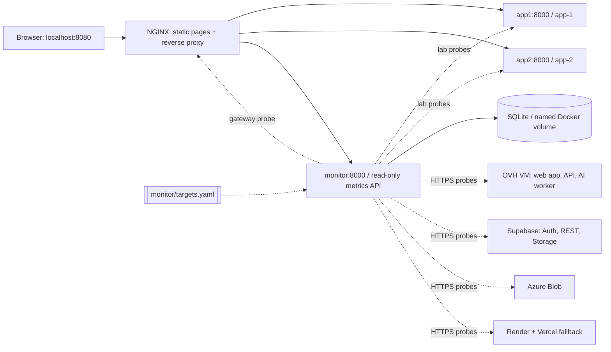

# CloudGuard — Multi-Cloud Monitoring for RoadWatch.AI

CloudGuard watches our final-year project, RoadWatch.AI, across every cloud service it
runs on: the OVH virtual machine (frontend, API and AI worker containers), Supabase (Auth,
REST gateway, Storage and, through the API, Postgres), Azure Blob Storage, and the Render and
Vercel fallback hosts. It measures each one against service level objectives (SLOs) with error
budgets. A local lab of two FastAPI replicas behind NGINX stays alongside it, as the part that
is safe to break on purpose. Every probe target and SLO is configuration
([`monitor/targets.yaml`](monitor/targets.yaml)), not code.

No paid cloud, API account, secret key, or host Python installation is required. Designed for
Professional Elective-II: Virtualisation and Cloud Computing.

## Quick start (Windows PowerShell)

Install Docker Desktop with Linux containers and Compose enabled, and start its
engine. The first build needs internet access to download public images and Python
packages. Subsequent operation uses local services and local frontend assets.

```powershell
cd C:\Users\ApolloAdmin\OneDrive\Desktop\cloudguard
docker version
docker compose config --quiet
docker compose up -d --build --wait --wait-timeout 180
docker compose ps
```

Open the [landing page](http://localhost:8080/) or the
[operations dashboard](http://localhost:8080/dashboard). Allow about 5–15 seconds
for the first measurements. A genuine startup probe failure may be recorded while
NGINX is coming online; history is not reset or hidden.

Stop the stack while keeping measurements:

```powershell
docker compose down
```

Start it again with the same `up` command. The named volume survives normal `down`,
image rebuilds, and container replacement. Do not use `down -v` if you want to keep
history: that option deletes the database volume.

## Architecture



Only NGINX publishes a port, bound to `127.0.0.1`. Other services communicate using
Compose DNS on a private bridge network. The gateway probe traverses NGINX's actual
application upstream, rather than treating a healthy replica as proof that the proxy
works. NGINX resolves service addresses dynamically after container replacement.

| Component | Responsibility |
|---|---|
| `backend/` | FastAPI `/`, `/health`, and validated `/echo`; visible replica identity |
| `monitor/` | Probe worker (one task per target), SQLite storage, metrics, SLO and incident APIs |
| `monitor/targets.yaml` | Every probe target, environment ("plane") and SLO; mounted read-only into the monitor |
| `frontend/` | Static landing page and dashboard; local CSS, canvas chart, vanilla JavaScript |
| `nginx/` | Static hosting, round-robin upstreams, eligible error retry, security headers |
| `scripts/` | Local operator actions with persistent audit records; verification workflow |
| `tests/` | Isolated unit/API tests plus real running-stack checks |
| `docs/` | Demonstration guide, design references, and observed validation results |
| `screenshots/` | Real browser captures of the running system |

`database/` is reserved for future utilities. The active database is in the Docker
volume, not the OneDrive project folder, to avoid SQLite locking/sync conflicts.

## What CloudGuard watches

Targets are grouped into three environments ("planes"), each with its own status:

| Plane | Targets | Probe interval |
|---|---|---|
| RoadWatch production | web app `/healthz`; `/config.js` safety; API `/api/health`; API → database (`/api/health?deep=1`); AI worker and queue (`/api/status`); Supabase Auth health; Supabase sign-in policy (`/auth/v1/settings`); Supabase REST gateway (must refuse the publishable key a schema listing); Supabase Storage; Azure evidence container (must refuse anonymous listing) | 30 s – 5 min |
| Fallback (DR) | Render API `/health`; Vercel web app | 5 min |
| Local lab | app-1, app-2, the NGINX gateway | 5 s |

Production is observe-only, and probed gently: the API's deep check reads 12 database tables,
so it runs every 5 minutes. Probes are `GET`/`HEAD` only, carry the user agent
`CloudGuard/2.0 (read-only uptime monitor)`, and their first runs are spread 1.5 s apart
(two new connections opened at the same instant to the RoadWatch server were measured taking
about 1 s longer than one alone).

A probe is healthy when its HTTP status is 2xx (or one listed under `expect.status`), every
`expect.body_contains` string is present, no `expect.body_excludes` string is, and every
`expect.json` path has an allowed value. `metrics:` copies numbers out of the JSON body into
each sample, for example the API's own database latency (`db_latency_ms`), queue depth and
worker heartbeat age. Every HTTPS probe also records `tls_days_left` from the server
certificate.

A failing **critical** target makes its plane an *outage*; a failing non-critical one makes it
*degraded*; any target without a fresh sample makes it *unknown*. In the lab the gateway is
critical and the replicas are not, which keeps the original healthy / degraded / outage meaning.

To add or change a target or SLO, edit `monitor/targets.yaml` and run
`docker compose restart monitor`. The file is validated at start and every problem is reported
at once (`docker compose logs monitor`). `${NAME}` and `${NAME:-default}` are read from the
monitor's environment. The only key CloudGuard sends is the Supabase **publishable** key, which
every RoadWatch visitor already downloads in `/config.js`; a Supabase secret key or a
`service_role` JWT in a header or URL stops the monitor at start.

## Service level objectives

Every SLO is "good checks ÷ valid checks ≥ goal" over a rolling window (at most
`RETENTION_DAYS`):

| Objective | Good check | Valid check |
|---|---|---|
| `availability` | healthy | every check |
| `latency` | healthy and at or under `threshold_ms` | healthy checks |
| `metric` | recorded metric within `min` / `max` | checks that reported the metric |

- **SLI** (indicator) = good ÷ valid. **SLO** = the goal, e.g. 99.5% over 7 days.
- **Error budget** = the (100 − goal)% of valid checks allowed to be bad. Budget left =
  `100 × (1 − bad ÷ (valid × allowed bad fraction))`. Below 0% the SLO is **breached**; below
  25% it is **at risk**. A 100% goal leaves no budget and is refused.
- **Burn rate** = the bad fraction over the last hour ÷ the allowed bad fraction. 1× spends
  exactly the whole budget over the window; 2× or more marks the SLO at risk.
- **SLA** (`sla_percent`, optional) = the looser promise to users, so the team is warned before
  the promise is broken.
- **Allowed downtime** (availability SLOs) = window × allowed fraction, e.g. 50.4 minutes per
  7 days at 99.5%. Bad checks × probe interval is shown as a rough estimate of time out of
  objective.
- **Coverage** = how much of the window the samples actually span. Time the monitor was off is
  neither good nor bad, so a fresh install shows "6 min of 7 d observed" rather than a week of
  invented success.

The shipped SLOs cover API and web availability (99.5%, SLA 99%), API latency (95% within
800 ms), database round trip (90% under 2 s; the database is in Tokyo and the VM in the UK),
worker online (95%), sign-in availability (99.5%), the TLS certificate (21+ days left),
fallback readiness and the lab gateway. Select an SLO row on the dashboard to see its
calculation with the current numbers.

## Dashboard interactions

- An environment switcher (RoadWatch production, Fallback, Local lab) with a live status dot
  each; the banner, headline cards, service cards, SLOs and incident log follow the selection.
- Live per-service health, current response time, successful-probe average latency, observed
  availability, check totals, and the latest recorded metrics (database latency, queue depth,
  certificate days left).
- A service level objective table with error budget bars, burn rate and a calculation dialog.
- A provider map for the cloud planes; the NGINX traffic flow and load-balancer tester for the lab.
- Window selection (1 hour, 24 hours, 7 days) and chart series selection: any target's
  response time, or a recorded metric such as the API's database latency.
- Canvas chart inspection with pointer movement or keyboard left/right arrows after focus.
- Incident type/component filters and a scrollable recent-transition table.
- Per-instance detail dialogs, real application request testing, and a recovery guide.
- Dark/light themes and focus mode for an uncluttered operational view.
- Pause/resume automatic **UI refresh**; the worker continues collecting samples.
- An interactive architecture introduction at `/`, with subtle pointer highlights.

No frontend framework, external fonts, hosted JavaScript, or internet-dependent
chart library is required. Reduced-motion settings and touch devices disable
pointer effects. Decorative hero movement is labelled an architecture illustration,
not live traffic. All health colours and displayed metrics come from recorded probes.

## API routes

All URLs below use `http://localhost:8080`:

| URL | Returns |
|---|---|
| `/healthz` | NGINX liveness only; not proof that the application works |
| `/api/app/` | Application identity and message |
| `/api/app/health` | Responding replica's health and monotonic process uptime |
| `/api/app/echo?message=hello` | Validated message (1–200 characters) and replica identity |
| `/api/monitor/health` | Monitoring-worker liveness; 503 if no recent completed cycle |
| `/api/monitor/targets` | Configured planes, targets and SLOs (request headers are never returned) |
| `/api/monitor/summary?hours=24` | Per-plane status, and per-target aggregates, latest sample and metrics |
| `/api/monitor/history?target=gateway&hours=24` | Up to 120 adaptive time buckets of response time |
| `/api/monitor/history?target=rw-api-deep&metric=db_latency_ms` | The same buckets for one recorded metric |
| `/api/monitor/slos` | Every SLO: attainment, error budget left, burn rate, SLA, coverage, status |
| `/api/monitor/incidents?limit=30` | Persisted failure/recovery transitions, newest first |
| `/api/monitor/audit?limit=30` | Local operator actions, newest first |
| `/api/app/openapi.json` | Application API schema |
| `/api/monitor/openapi.json` | Monitoring API schema |

`hours` must be 1–168 and `limit` 1–100; history targets must be configured target ids, and
`metric` one that target records. Invalid requests return 422. Interactive FastAPI docs are disabled
because their default UI downloads third-party JavaScript; JSON schemas work offline.

```powershell
Invoke-RestMethod http://localhost:8080/api/app/health
1..10 | ForEach-Object { (Invoke-RestMethod http://localhost:8080/api/app/).instance }
Invoke-RestMethod http://localhost:8080/api/monitor/summary | ConvertTo-Json -Depth 5
```

## Failure and recovery demonstration

Keep the dashboard open. Establish that both replicas are healthy, then:

```powershell
docker compose stop app1
# Wait about 5–15 seconds and inspect the dashboard.
1..10 | ForEach-Object { (Invoke-RestMethod http://localhost:8080/api/app/).instance }
docker compose start app1
# Wait for a successful probe and the app-1 recovery event.
```

While app1 is stopped, the expected state is **degraded**: app-1 is unhealthy but
the gateway remains available through app-2. After recovery, the current state is
healthy; historical failed checks remain in the calculation.

For the same operations **with operator audit records**, use:

```powershell
.\scripts\replica.ps1 -Action stop -Service app1
.\scripts\replica.ps1 -Action start -Service app1
```

The wrapper records requested and succeeded/failed actions in SQLite. Direct Docker
commands do not identify an operator to CloudGuard; their effects are recorded as
health transitions only. Audit records use the actor `local-cli`, not an authenticated
person. This is an operational trace, not a tamper-proof compliance log.

To demonstrate automatic restart after an **unexpected application process exit**:

```powershell
.\scripts\replica.ps1 -Action crash -Service app1
docker inspect --format '{{.RestartCount}}' cloudguard-app1-1
docker compose ps
```

The script kills only the Uvicorn child process inside the selected replica.
Docker's `unless-stopped` policy restarts the container. A brief crash can recover
between probes, so a new monitor incident is not guaranteed; the audit record and
Docker restart count provide separate evidence.

Three distinct mechanisms matter:

1. **Detection:** the monitor records a failing probe and one incident per transition.
2. **Failover:** NGINX retries another upstream for connection errors, timeouts, and
   configured 502/503/504 responses (at most two tries). This is not perfect failover
   for every possible request or failure mode; non-idempotent requests are not forcibly retried.
3. **Restart:** Docker restarts an unexpectedly exited process. A deliberately
   stopped container stays stopped until `docker compose start app1`.

An unhealthy Docker health check alone does **not** restart a running container.
This project does not mount the Docker socket or grant the monitor host control.

## How measurements are calculated

Each target is probed independently on its own interval. Lab targets are healthy on HTTP
success, valid JSON, `status=healthy`, and the expected identity; every other target follows
its `expect` rules in `targets.yaml`. Failures include timeouts (the whole exchange must finish
within the target's timeout), connection errors, rejected TLS certificates, unexpected status,
missing or forbidden text, malformed JSON, and unexpected values. Fresh probe connections
measure what a new visitor sees (DNS, TCP, TLS) and avoid idle keep-alive timeout races.

- **Observed availability:** `100 × successful recorded checks / all recorded checks`
  for the target inside the selected rolling window. An empty window returns `null`,
  displayed as a dash. These are probe success ratios, not measured percentage of
  wall-clock uptime or a production SLA guarantee.
- **Average latency:** arithmetic mean of successful probe round-trip times only.
  Failed attempt duration is stored, but not included in successful-response averages.
- **Current latency:** the latest healthy, fresh probe; otherwise a dash. Dashboard
  top cards describe the selected plane's headline target (the backend API, the Render API,
  or the lab gateway), while service cards show their independent data.
- **Browser request latency:** separately labelled round-trip time measured by the
  request tester, not added to periodic probe totals.
- **Observation window:** first and last actual recorded sample in the selected period.
  Checks before a shutdown remain, but time while the monitor is off is unobserved.
  No successful checks are invented for gaps, and gaps are not counted as downtime.
- **History:** up to 120 buckets adapt to the actual observed period. Each bucket
  averages successful samples and reports total/failing checks. Red marks indicate
  failures; all-failure buckets have no successful latency.
- **Incidents:** an initial unhealthy sample or healthy→unhealthy transition; repeated
  failures do not duplicate events. Recovery means unhealthy→healthy, not initial startup success.
- **Plane status:** healthy if every target in the plane has a fresh healthy sample;
  degraded if only non-critical targets fail; outage if a critical target fails; unknown
  if any sample is missing or stale. Staleness is `max(15, 3 × interval + timeout)` seconds
  per target.

SQLite stores UTC epoch timestamps. The browser formats them in the viewer's local
timezone. The worker uses monotonic time for durations, WAL mode for SQLite, bounded
API parameters, and seven-day retention by default. Old records are pruned once a minute.
A single worker owns writes; do not scale the monitor. A volume from CloudGuard 1.x keeps its
history: the two new sample columns (`status_code`, `metrics`) are added at start.

## Configuration

Defaults are in Compose and `.env.example`; no `.env` is required. To customize:

```powershell
Copy-Item .env.example .env
# Edit .env, then:
docker compose up -d --build --wait --wait-timeout 180
```

| Variable | Default | Allowed / meaning |
|---|---|---|
| `CLOUDGUARD_PORT` | 8080 | Free host TCP port; remains bound to localhost |
| `CHECK_INTERVAL_SECONDS` | 5 | Lab probe interval, 1–3600 seconds (other targets set their own in `targets.yaml`) |
| `CHECK_TIMEOUT_SECONDS` | 2 | Lab probe timeout, 0.1–60 seconds and not above the interval |
| `RETENTION_DAYS` | 7 | 1–365 days; UI window is capped at seven days; SLO windows cannot exceed it |
| `SUPABASE_PUBLISHABLE_KEY` | RoadWatch's key | `sb_publishable_...` sent to Supabase health endpoints; a secret key is refused |
| `TARGETS_FILE` | `/config/targets.yaml` | Set by Compose to the mounted `monitor/targets.yaml` |

After editing `monitor/targets.yaml`, run `docker compose restart monitor`. After editing `nginx/nginx.conf`, run `docker compose exec nginx nginx -t`, then
`docker compose exec nginx nginx -s reload`. Static frontend changes need a browser
refresh. Backend and monitor source changes need an image rebuild.

## Tests

The test image includes Python, so the Windows Python launcher is not needed:

```powershell
docker build -f tests/Dockerfile -t cloudguard-tests .
docker run --rm cloudguard-tests
docker run --rm --network cloudguard_cloudguard cloudguard-tests python tests/live_check.py --expect healthy --requests 40
docker run --rm --network cloudguard_cloudguard cloudguard-tests python tests/stability.py
```

The last command observes a minute of real lab cycles and fails if any new failed lab
probe appears. Do not inject failures during that check. Production and fallback targets
depend on the internet and on other people's servers, so the live and stability checks report
their status but never fail on it.

For repeatable unit, smoke, and optional live failure tests:

```powershell
.\scripts\verify.ps1
.\scripts\verify.ps1 -FailureRecovery
```

The failure option temporarily stops app1, checks traffic via app2, and restores app1
in a `finally` block. See [actual validation results](docs/validation.md) and the
[five-minute submission sequence](docs/demo.md). Screenshot files are actual browser
captures; their values are historical observations, not promised current metrics.

## Security and limitations

- Python services run as non-root with read-only root filesystems, dropped capabilities,
  and no-new-privileges; SQLite alone has a writable named volume.
- Only localhost NGINX is published. No public hosting, cloud credentials, Docker socket,
  or browser administrative mutation endpoint is used.
- CloudGuard sends only public keys. It refuses a Supabase secret key or `service_role` JWT
  in any header or URL at start, never returns request headers from its API, and probes with
  `GET`/`HEAD` only. The `rw-config`, `supabase-auth-policy`, `supabase-rest` and
  `azure-blob-private` targets are security checks: they fail if a secret key appears in the
  public config, the sign-in policy drifts, the REST gateway lists the schema to the
  publishable key, or the evidence container allows anonymous listing.
- Input lengths and query values are constrained; SQL uses parameters. Monitoring errors
  return safe messages. NGINX sets CSP, framing protection, MIME protection, and no-store.
- Local Docker access is required for replica administration. Login and role-based
  authentication, encrypted transport, and the optional file vault are not implemented.
  Do not expose this local lab as a public production service without further hardening.
- One Docker Desktop host, one NGINX instance, one worker, and one database are single
  points of failure. Samples are periodic, so short failures can go undetected.
- No contractual SLA target, synthetic uptime, guaranteed request losslessness, or
  automatic healing of a running-but-unhealthy process is claimed.
- Dependencies are pinned at the direct-package level; full transitive locking, dependency
  scanning, TLS, authenticated audit identities, and scheduled database backups are future work.

## Troubleshooting

- Engine unavailable: start Docker Desktop, switch to Linux containers, and run
  `docker version` until the Server section is present. No project command changes system settings.
- Port busy: set `CLOUDGUARD_PORT` to a free port in `.env` and rerun `up`; use that port in URLs.
- Inspect errors: `docker compose ps`, `docker compose logs --tail 100 monitor nginx app1 app2`.
- Monitor unhealthy: check interval/timeout ranges, volume permissions, and worker logs.
- Missing history: the volume belongs to this Compose project (`cloudguard`); use the
  same project and do not remove its volume. Removing/recreating containers is safe.
- If PowerShell policy blocks scripts, use the documented direct Docker commands or
  seek an approved script-execution method; changing machine policy is not required.

## Academic concepts

Docker Desktop runs Linux containers on its Linux environment; containers isolate
processes while sharing that Linux kernel. This is OS-level virtualisation, distinct
from a full VM for every application. Two replicas demonstrate horizontal replication;
NGINX demonstrates reverse proxying, service discovery, and load balancing. Compose
provides repeatable provisioning; the network isolates internal services; a named
volume decouples data lifetime from containers. Probes, incident transitions, failover,
restart policy, and observed availability demonstrate monitoring, fault tolerance,
recovery, and honest SLA measurement within a local cloud-like system.
